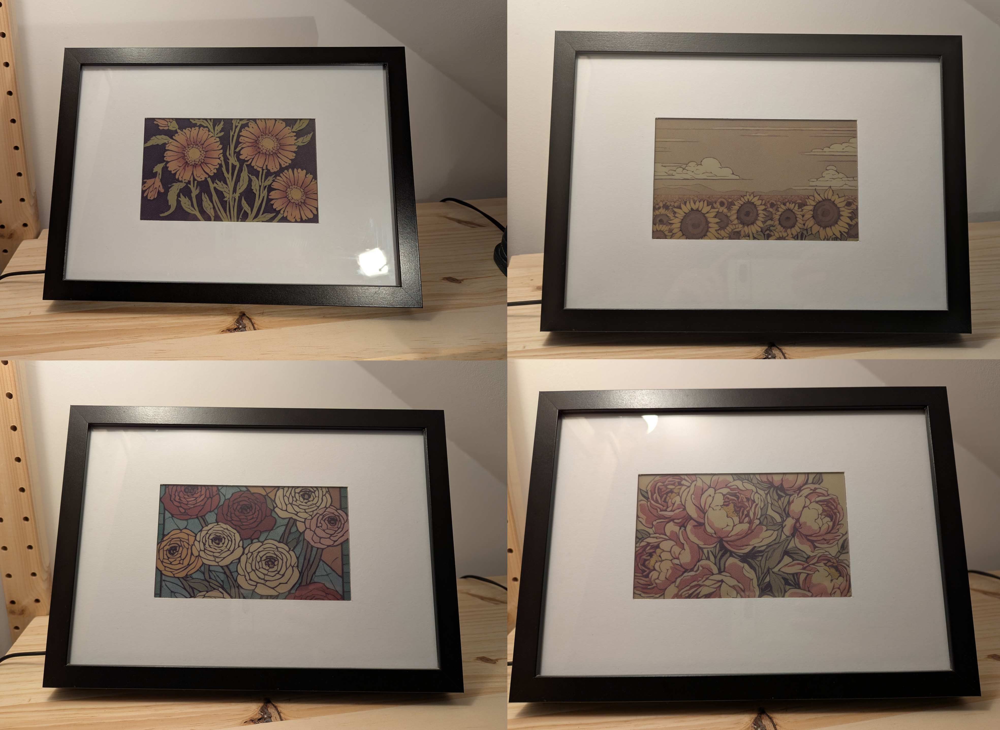

# PaperPi5-AI

A self-contained AI picture frame: a **Raspberry Pi 5** runs Stable Diffusion
(SDXL Turbo via [OnnxStream](https://github.com/vitoplantamura/OnnxStream))
entirely offline and shows a new picture every day on a **Pimoroni Inky
Impression 7.3" (2025 Edition, Spectra 6)** e-paper display.

Based on [dylski/PaperPiAI](https://github.com/dylski/PaperPiAI) by Dylan
Banarse (MIT), which targets a Pi Zero 2 on Bullseye. This fork is reworked
for the Pi 5 and Raspberry Pi OS Bookworm.



## What's different from upstream

| Problem with upstream on a Pi 5 | Fix here |
| --- | --- |
| `inky==1.5.0` uses RPi.GPIO, which doesn't work on a Pi 5, and doesn't know the Spectra 6 panel | Uses `inky>=2.1` (gpiod-based, supports Spectra 6 / E673) |
| SPI claims GPIO8, so the display fails with *"GPIO8 claimed by spi0 CS0"* | Installer adds `dtoverlay=spi0-0cs` (and `i2c1-pi5`) to `/boot/firmware/config.txt`, as Pimoroni's installer does |
| Model cloned without `git lfs install`, so you get tiny pointer files and have to fetch weights by hand | Installer runs `git lfs` properly, resumes broken downloads, and **verifies** the weights |
| `--rpi-lowmem` (Pi Zero mode) makes generation very slow | Uses `--ram` (whole UNET in RAM) on the Pi 5 |
| cron + hard-coded `/home/dylski` paths | `config.toml` + systemd timer and button service |
| Easy to shut down by accident with button D | Hold D for 3 seconds to shut down |

## Hardware

* Raspberry Pi 5 (tested design: 16 GB; 8 GB should be fine)
* Pimoroni Inky Impression 7.3" **2025 Edition (Spectra 6)**, pressed fully onto the 40-pin header
* Good power supply (official 27 W USB-C)
* Active cooler recommended: generation uses all four cores for a few minutes
* microSD card or SSD with **at least 32 GB** (the model is ~8 GB, the build needs a few more)

## Install

1. Flash **Raspberry Pi OS Lite (64-bit, Bookworm)** with Raspberry Pi
   Imager. Set the hostname, user, Wi-Fi and SSH in the Imager settings.
2. SSH in, then:

```bash
sudo apt update && sudo apt install -y git
git clone https://github.com/sudo-broberts66/paperpi5-ai.git
cd paperpi5-ai
scripts/install.sh
```

The installer does everything: system packages, SPI/I2C, the boot config
lines, a Python venv, the OnnxStream build (~10-20 min on a Pi 5), the ~8 GB
model download, `config.toml`, and the systemd services. It can be re-run
safely: finished steps are skipped and an interrupted model download resumes.

3. Reboot when it tells you to, then check everything:

```bash
sudo reboot
```

```bash
cd ~/paperpi5-ai && scripts/doctor.sh
```

Every line should say **PASS**. Each **FAIL** comes with a suggested fix.

4. Test the display (six colour bars):

```bash
venv/bin/python src/test_display.py
```

5. Make the first picture now instead of waiting for the timer:

```bash
sudo systemctl start paperpi.service
```

```bash
journalctl -fu paperpi.service
```

## Daily use

* A new picture is made on the schedule in `config.toml` (default 06:00 every day).
* Buttons on the side of the display:
  * **A**: latest picture
  * **B**: older picture
  * **C**: newer picture
  * **D**: hold for 3 s to shut down safely
* Pictures (and a `.txt` with each prompt) are saved in `images/`.

## Running on its own

Once `scripts/install.sh` has finished, the frame needs no further setup.
After a power cycle:

* **The picture timer is enabled at boot.** It makes a new picture at each
  scheduled time.
* **Missed pictures catch up.** If the Pi was off at a scheduled time, that
  picture is made shortly after the next boot (the timer uses `Persistent=true`).
* **The button service starts at boot.**
* **The screen keeps the last picture with the power off**, because e-paper
  holds its image without power.

A picture that was being generated when the power was cut is lost. It isn't
retried; the next one comes at the next scheduled time, or you can start
one by hand with `sudo systemctl start paperpi.service`.

### Check it after a reboot

```bash
systemctl list-timers paperpi.timer
```

The NEXT column shows when the next picture will be made.

```bash
systemctl is-enabled paperpi.timer paperpi-buttons.service
```

Both should say `enabled`. `scripts/doctor.sh` checks these along with everything else.

### Worth doing once

1. **Set the time zone.** The schedule uses the Pi's local time. If `date`
   shows the wrong time, set your zone with `sudo raspi-config` →
   Localisation Options → Timezone.
2. **Shut down with button D** (hold 3 s) rather than pulling the plug.
   Cutting power while the Pi is writing can corrupt the SD card. Unplug once
   the green light stops flashing.
3. **Leave Wi-Fi connected if you can.** Generating doesn't need the internet,
   but the Pi 5 has no clock battery unless you fit one, so it gets the time
   from the network at boot. Without it, the clock (and so the schedule) can be wrong.
4. **Optionally limit stored pictures** with `generate.keep_images = 365` in
   `config.toml` (keeps the newest 365). Each picture is only about 1 MB.

## Changing the schedule

How often and when new pictures are made is set by one line in `config.toml`:

```toml
[schedule]
on_calendar = "*-*-* 06:00:00"
```

The format is `day-of-week year-month-day hour:minute:second`, where `*`
means "every". So `*-*-* 06:00:00` means every day at 06:00.

### Examples

| Pictures | `on_calendar` |
| --- | --- |
| Once a day at 6am | `"*-*-* 06:00:00"` |
| Twice a day, 6am and 6pm | `"*-*-* 06,18:00:00"` |
| Three times a day, 7am, 1pm and 7pm | `"*-*-* 07,13,19:00:00"` |
| Every 4 hours (00:00, 04:00, 08:00 ...) | `"*-*-* 00/4:00:00"` |
| Every 3 hours from 8am to 8pm | `"*-*-* 08..20/3:00:00"` |
| Every hour | `"hourly"` |
| Weekdays at 7am | `"Mon..Fri *-*-* 07:00:00"` |
| Weekends at 9:30am | `"Sat,Sun *-*-* 09:30:00"` |
| Once a week, Monday 6am | `"Mon *-*-* 06:00:00"` |

* Hours use the 24-hour clock in the Pi's local time zone.
* `a,b,c` lists times, `a..b` is a range, and `/n` means "every n".

### Apply the change

After editing `config.toml`, reinstall the timer. This only takes a few seconds:

```bash
scripts/install.sh --services
```

Then check the next run time:

```bash
systemctl list-timers paperpi.timer
```

To check a schedule before using it, ask systemd to list its next few times:

```bash
systemd-analyze calendar --iterations=5 "*-*-* 06,18:00:00"
```

### How often is too often?

Each picture takes a few minutes to generate, plus `display.delay_seconds`
(2 minutes by default) before the screen refreshes. A run never overlaps the
previous one. Every 30-60 minutes is a sensible minimum. Refreshing far more
often than that keeps the Pi hot, and e-paper colours look worse when the panel is warm.

## Configuration

Edit `config.toml` (created from `config.example.toml`). The main settings:

| Setting | Default | Notes |
| --- | --- | --- |
| `generate.steps` | 3 | SDXL Turbo looks good at 1-4 |
| `generate.ram_mode` | true | Fast. Set false if you run out of memory |
| `generate.keep_images` | 0 | Keep only the newest N images (0 = all) |
| `display.portrait` | false | Portrait images, rotated onto the panel |
| `display.saturation` | 0.5 | Colour saturation used when dithering to the 6 inks |
| `display.delay_seconds` | 120 | Let the Pi cool before refreshing the panel |
| `display.type` | "" | Auto-detect. Set `"spectra73"` if detection fails |
| `llm.enabled` | true | Let the local LLM write prompts (see below) |
| `llm.theme` | alien planet landscape | What the LLM is asked to describe |
| `schedule.on_calendar` | `*-*-* 06:00:00` | systemd [OnCalendar](https://www.freedesktop.org/software/systemd/man/systemd.time.html#Calendar%20Events) format |

After changing `schedule.on_calendar`, run `scripts/install.sh --services`.

See [Prompt libraries](#prompt-libraries) to change what gets drawn.

## Prompt libraries

A prompt library is a JSON file in `prompts/`. It holds a **list of lists**.
Each picture's prompt is built by picking one random entry from each inner
list and joining them with spaces, in order.

```json
[
    ["single stem rose", "bouquet of tulips"],
    ["as a woodblock print", "as a vintage postcard"]
]
```

That small example can produce "bouquet of tulips as a woodblock print".

Bundled libraries:

| File | Lists | Example prompt |
| --- | --- | --- |
| `prompts/flowers.json` | subject, style | single iris as a vintage postcard |
| `prompts/planets.json` | landscape, sky, detail, style | crystal canyon under two suns a crashed spaceship as a linocut print |

### Switching library

When [Local LLM prompts](#local-llm-prompts) are on, the LLM takes its ideas
from `llm.inspiration_file`, and `paths.prompts_file` is only the fallback.
With the LLM off, `paths.prompts_file` is used for every picture.

Set `paths.prompts_file` in `config.toml`. The change applies from the next picture:

```toml
[paths]
prompts_file = "prompts/planets.json"
```

To try one library once without changing the config:

```bash
venv/bin/python src/generate_picture.py --prompts prompts/planets.json && venv/bin/python src/display_picture.py
```

### Editing or writing a library

* Add or remove entries in any list. Keep the commas between entries and the quotes around each one.
* Add a whole new list (for example lighting or mood); it becomes another part of every prompt.
* Use `""` entries to make a part optional. In `planets.json`, three of the detail entries are empty, so about a quarter of pictures have no extra detail.
* Keep the total prompt short (under about 60 words). SDXL ignores text past its limit.
* Flat, bold, low-colour styles (prints, posters, flat illustration) look best on the 6-colour panel. Photo-realistic and soft gradient styles dither into noise.
* Check your file before the next scheduled run:

```bash
venv/bin/python -m json.tool prompts/planets.json > /dev/null && echo OK
```

## Local LLM prompts

A small language model running on the Pi writes each picture's prompt, so
every picture gets a fresh description instead of joined fragments. It's
fully offline once installed.

For each picture:

1. A few random fragments are picked from `llm.inspiration_file`
   (`prompts/planets.json`): for example a landscape, a sky and a detail.
2. The LLM ([Qwen2.5-3B-Instruct](https://huggingface.co/Qwen/Qwen2.5-3B-Instruct-GGUF),
   run by [llama.cpp](https://github.com/ggml-org/llama.cpp)) is asked for one
   short scene on `llm.theme`, inspired by those fragments, in a style suited
   to the 6-colour panel, and different from the last few prompts.
3. Its reply is cleaned up to one line, and an art style from the library's
   last list is added (for example "as a linocut print").
4. Stable Diffusion draws it, as before. The prompt is saved in the `.txt`
   next to the picture, ending in `source=llm`.

**If the LLM fails** (missing model, crash, odd reply, or it takes longer than
`llm.timeout_seconds`), the picture is made from the prompt library
(`paths.prompts_file`) instead, ending in `source=library`. A bad LLM run
never costs a picture.

The LLM runs as a separate process that exits before Stable Diffusion starts,
so the two never share memory. Writing a prompt should take under a minute on a Pi 5.

### Installing

New installs get the LLM automatically from `scripts/install.sh`. To add it to
an existing install, from the `paperpi5-ai` folder:

```bash
scripts/install.sh --llm
```

This compiles `llama-cpp-python` (roughly 10-20 minutes) and downloads the
~2 GB model to `models/llm/`. If the download is interrupted, run it again to resume. Then check it:

```bash
scripts/doctor.sh --llm
```

### Trying prompts

Write a few prompts without making pictures:

```bash
venv/bin/python src/llm_prompt.py --count 5
```

Try a different theme once:

```bash
venv/bin/python src/llm_prompt.py --count 3 --theme "an underwater city on an ocean moon"
```

Make one picture with or without the LLM, whatever the config says:

```bash
venv/bin/python src/generate_picture.py --llm
```

```bash
venv/bin/python src/generate_picture.py --no-llm
```

### Settings (`[llm]` in `config.toml`)

| Setting | Default | Notes |
| --- | --- | --- |
| `enabled` | true | false = use only the prompt library |
| `theme` | "a sci-fi landscape on an alien planet" | The frame's subject. Change it to anything |
| `inspiration_file` | `prompts/planets.json` | Random fragments from here steer each prompt |
| `keep_style` | true | Take the art style from the library's last list instead of letting the LLM choose |
| `temperature` | 0.9 | Higher = more surprising, lower = safer (0.6-1.1) |
| `max_words` | 35 | Length of the LLM's scene description |
| `recent_count` | 8 | How many recent prompts it's asked to avoid repeating |
| `timeout_seconds` | 300 | Fall back to the library after this long |
| `model`, `model_url` | Qwen2.5-3B Q4_K_M | Any instruct GGUF model works; run `scripts/install.sh --llm` after changing |

If you change `theme` to something other than planets, point
`inspiration_file` at a matching library too (or set `keep_style = true` with
a library whose last list is styles, such as `flowers.json`).

The default model's license ([Qwen Research License](https://huggingface.co/Qwen/Qwen2.5-3B-Instruct/blob/main/LICENSE))
allows personal, non-commercial use, which covers a home picture frame.

## Manual commands

```bash
venv/bin/python src/generate_picture.py --help
```

```bash
venv/bin/python src/generate_picture.py --prompt "a lighthouse at dusk, woodcut print"
```

```bash
venv/bin/python src/display_picture.py images/output.png
```

```bash
scripts/doctor.sh --generate
```

The last command also makes a quick 1-step test image and reports how long it took.

## Troubleshooting

**`GPIO8 ... currently claimed by spi0 CS0`**: `dtoverlay=spi0-0cs` is missing
from `/boot/firmware/config.txt`. Re-run `scripts/install.sh`, then reboot.

**`No EEPROM detected`**: the board isn't being seen on I2C. Power off and
reseat the display on all 40 pins, and check `sudo raspi-config nonint do_i2c 0`.
If it still fails, set `display.type = "spectra73"` in `config.toml` to skip
detection.

**`inky ... too old`** or **`RPi.GPIO` errors**: an old inky is being used.
Always run scripts with `venv/bin/python`, and run `venv/bin/pip install -U -r requirements.txt`.

**Model errors / `git-lfs pointers`**: the weights didn't fully download.
Re-run `scripts/install.sh` to resume, then `venv/bin/python src/check_model.py`.

**Generation crashes or produces garbage**: rebuild OnnxStream with
`scripts/install.sh --rebuild`. If it's out of memory, set `generate.ram_mode = false`.

**LLM prompts not being used** (`source=library` in the `.txt` files): run
`scripts/doctor.sh --llm`, and check the reason in
`journalctl -u paperpi.service -n 100` (look for "LLM prompt failed").
`scripts/install.sh --llm --rebuild` recompiles llama.cpp if it crashes.

**Washed-out or odd colours**: try `display.saturation` between 0.3 and 0.8.
E-paper is also temperature-sensitive, so increase `display.delay_seconds` if
the Pi runs hot.

Logs:

```bash
journalctl -u paperpi.service -n 100
```

```bash
journalctl -u paperpi-buttons.service -n 50
```

## Development

The non-hardware parts have tests (no Pi needed):

```bash
pip install pytest pillow numpy && python -m pytest tests
```

## Credits

* [dylski/PaperPiAI](https://github.com/dylski/PaperPiAI): the original project
* [vitoplantamura/OnnxStream](https://github.com/vitoplantamura/OnnxStream): Stable Diffusion on the Raspberry Pi
* [pimoroni/inky](https://github.com/pimoroni/inky): display driver
* [llama.cpp](https://github.com/ggml-org/llama.cpp) and [llama-cpp-python](https://github.com/abetlen/llama-cpp-python): local LLM
* [Qwen2.5](https://huggingface.co/Qwen/Qwen2.5-3B-Instruct-GGUF): the default prompt-writing model
